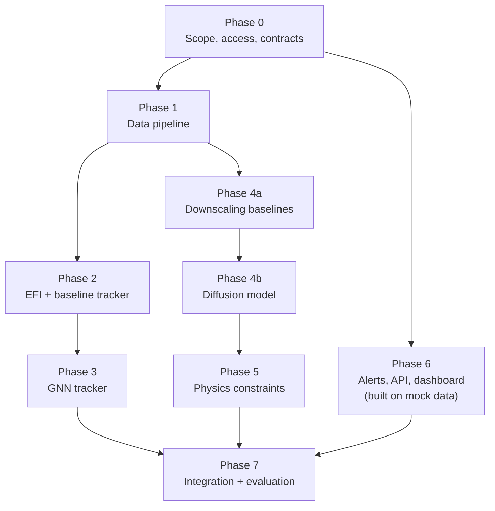
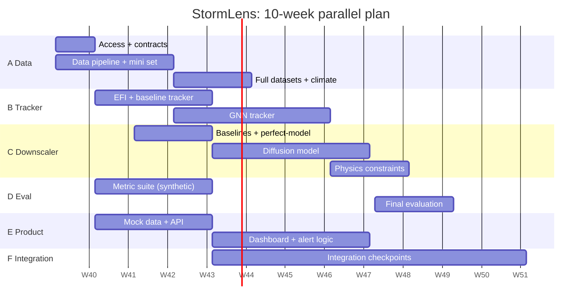

# StormLens Pipeline: Build Plan, Tech Stack and Parallel Execution

This document covers:
1. Feasibility verdict and recommended scope
2. Verification of the problem-statement guide (datasets, stack, claims)
3. Final tech stack
4. Phase-by-phase pipeline with how-to
5. Parallel workstreams and how to merge them
6. Evaluation, risks, compute

---

## 1. Feasibility verdict

**Verdict: feasible and strong, but only if scoped carefully.** The architecture (icosahedral-mesh GNN, then diffusion downscaling) matches the current state of the art. GraphCast/GenCast use mesh GNNs, and NVIDIA's CorrDiff uses residual diffusion for kilometre-scale downscaling. Nothing in the idea is unrealistic. The risk is in a few claims and data assumptions that need fixing before building.

### What is solid
- Mesh-based GNN for global or regional weather: proven (GraphCast, GenCast).
- Diffusion for downscaling with better extremes and spectra than MSE-trained U-Nets: proven (CorrDiff, other recent work).
- 12 km to 5 km is only a **2.4x** upscaling factor, which is much easier than typical 25 km to 2 km setups.
- A rest-API alert layer is straightforward engineering.

### What is risky or needs fixing (details in section 2)
1. **No 5 km ground truth is named.** Diffusion needs paired low-res / high-res training data. IMDAA is 12 km and ERA5 is about 31 km.
2. **The GNN does not "calculate EFI".** EFI is a closed-form formula on ensemble vs climate. Compute it analytically and feed it to the GNN as input.
3. **ERA5 is the wrong climate for a NEPS-G EFI.** Model bias makes the index misleading. Use a model climate or bias-correct.
4. **NEPS-G history is short.** There is no 30-year archive of NEPS-G, so training on it alone will be data-starved.
5. **"Seconds on a cloud GPU" is optimistic.** True for tracking; diffusion needs many steps and many samples per member.
6. **Pinpoint coordinates and "5 km radius" alerts overstate certainty.** Output should be probabilistic.
7. **Physics-informed loss is harder for diffusion than for a regression net.** It is doable, but needs the right formulation (section 4, Phase 5).

### Recommended MVP scope (what to actually build and demo)
| Item | MVP choice |
|---|---|
| Domain | India + North Indian Ocean (about 0 to 40 N, 55 to 100 E) for Stage 2. Tracker can run globally or on the same domain. |
| Events | (a) Tropical cyclones (Amphan 2020 as flagship), (b) North India heatwaves. Cold waves and heat domes are stretch goals. |
| Variables out | Rain (6 or 24 h accumulation), 2 m temperature, 10 m wind. Humidity and wind are needed for the physics term. |
| Lead times | Tracking at days 3 to 10; downscaling shown at days 1 to 5 as primary, days 6 to 10 as probabilistic. |
| Compute | One 24 to 80 GB GPU is enough for regional patches. |

---

## 2. Verification of the problem-statement guide

### 2.1 Datasets

| Item in PS | Verdict | Issue | Recommendation |
|---|---|---|---|
| **NEPS-G (12 km ensemble)** | Good as the *primary input*; limited history | Short archive; access may need a data request to NCMRWF; reforecasts unlikely | Request access in Week 1. Use public backups in parallel (below). |
| **NCUM (12 km deterministic)** | Fine as a secondary input | Deterministic only | Use as extra conditioning or a baseline. |
| **IMDAA (12 km reanalysis)** | Good for India climatology and for NCUM-consistent training | Same 12 km as input, so **not** a 5 km target. Check which years are available. | Use for climatology and as consistent "truth" for the 12 km level, not for downscaling targets. |
| **ERA5 (about 31 km, 0.25 deg)** | Good for global climatology and pretraining | Coarser than 12 km. Climate from ERA5 vs a NEPS-G forecast is biased. | Use for pretraining and baselines. Bias-correct before EFI (see 2.3). |
| **5 km target data** | **Missing in PS** | Without it, Stage 2 cannot be trained or validated | See table 2.2. |
| **30-year baseline** | Fine for ERA5/IMDAA | A model climate (reforecasts) is the proper EFI baseline, and NEPS-G has none | Use ERA5 climate with quantile-mapping to NEPS-G, or use GEFS reforecasts as a stand-in. |
| **Event list (Amphan, heatwaves)** | Good test cases | Too few events to train on | Use as **case studies**; train on all-season data and evaluate on events. |

**Public backup inputs** (use if NEPS-G access is slow or limited):
- **ECMWF Open Data** (IFS ensemble, 0.25 deg): free and recent.
- **NOAA GEFS reforecast**: long history (decades), good for model-climate EFI and for training the tracker.
- **TIGGE**: multi-centre ensembles with long history, access via ECMWF.
- **WeatherBench 2**: ready-made ERA5 and baselines in cloud-friendly Zarr.

### 2.2 Choosing a 5 km (or finer) training target

This is the most important data decision. Options in order of preference:

| Option | Resolution | Variables | Pros | Cons |
|---|---|---|---|---|
| **NCUM-R regional model archive** | about 4 km | All (rain, T, wind, q) | Full physical consistency, so the physics loss is meaningful | Needs NCMRWF access; model-based, not observed |
| **IMERG (GPM)** | 0.1 deg (about 10 km) | Rain | Free, 2000 to present, observation-based | Barely finer than 12 km |
| **CHIRPS** | 0.05 deg (about 5 km) | Daily rain | Exactly 5 km, free | Daily only, blended with gauges |
| **ERA5-Land** | 0.1 deg (about 9 km) | T, wind, humidity, land | Free, long | Only slightly finer than 12 km |
| **IMD radar mosaics (DWR)** | 1 to 2 km | Rain, reflectivity | True high-res for events | Access and coverage limited, noisy |
| **Perfect-model test** (coarsen a high-res field to 12 km, then recover it) | any | any | Always possible; good for method development | Not the real task; only for debugging and ablations |

**Recommendation:** Try for **NCUM-R (about 4 km)** as the main target, aggregated to a 5 km grid. If not available, use **CHIRPS and IMERG for rain** and **ERA5-Land plus station data for temperature**. Always run the perfect-model test first, since it works on day one.

### 2.3 Methodology claims

| PS claim | Assessment | Fix |
|---|---|---|
| "GNN calculates the EFI against ERA5" | **Conceptually off.** EFI is a fixed integral: `EFI = (2/pi) * integral_0^1 (p - F(p)) / sqrt(p(1-p)) dp`, where `F(p)` is the fraction of ensemble members below the p-quantile of the climate. It is not a "standard deviation" measure and does not need learning. | Compute EFI and SOT (Shift of Tails) analytically with `xclim`/NumPy. Give them to the GNN as input features. |
| "GNN draws a macro bounding box" | Plausible but indirect | GNN predicts per-node event probability and a centre heatmap. Post-process into polygons/boxes. |
| "Standard CNN/U-Net smooths extremes" | **True** for MSE-trained models | Show this experimentally as your baseline. It is a strong result. |
| "Diffusion preserves amplitude" | **True in practice** but not guaranteed | Prove with power spectra and tail quantiles (section 6). |
| "Physics in loss function" | Doable, but diffusion loss is on noise/denoised output | Apply physics terms to the *denoised estimate* with a small weight, plus a hard coarse-consistency correction at inference (Phase 5). |
| "Moisture convergence for downpours" | Valid physics (`P - E = -div(qV) - dW/dt`) | Requires downscaling q and wind too, not just rain. |
| "Pinpoint coordinate, 5 km radius alerts" | **Overconfident** | Alert on **probability maps**: P(rain > threshold) per 5 km cell, then grade. |
| "Processes live inference in seconds" | Tracker: yes. Diffusion: depends on steps, domain, samples | Plan for seconds to a few minutes per member. Speed-ups: fewer sampler steps, patch tiling, distillation. Reword in the pitch. |
| "3 to 10 day 5 km foresight" | Downscaling does not add skill | Frame it as "localizing the *ensemble's* risk", not "predicting exact spots". |
| "Alert fatigue" use case | Good, and real | Back it with a clear metric: false-alarm area reduced vs district-level warnings. |
| "State-of-the-art" | Needs evidence | Compare against baselines; claim only what you measure. |

### 2.4 Tech stack review

| PS choice | Verdict | Better / safer choice |
|---|---|---|
| PyTorch / JAX | OK, but **pick one** | **PyTorch** (bigger community, PyG, PhysicsNeMo). Do not mix. |
| **DGL** for mesh GNN | Works, but development has slowed | **PyTorch Geometric (PyG)**, or plain PyTorch with scatter ops. Adapt GraphCast's open mesh-building code. |
| Hugging Face **Diffusers** | Good for fast prototyping | For production-quality weather, write a small **EDM-style** diffusion (Karras et al.) or adapt **NVIDIA PhysicsNeMo CorrDiff**. Diffusers' defaults target RGB images, not 5 to 10 channel weather fields. |
| Xarray + Dask | Excellent | Add **Zarr** for storage and `cfgrib`/ECCodes for GRIB2. |
| MetPy | Good for derived quantities | Add `xclim` (indices) and `wrf-python` only if WRF is used. |
| Cartopy | Good for static plots | Add MapLibre/Leaflet for the web dashboard. |
| (Missing) Verification | **Gap** | `xskillscore`, `scores`, `properscoring`; use WeatherBench 2 metric definitions. |
| (Missing) Experiment tracking, data versioning | **Gap** | Weights & Biases or MLflow; DVC. |
| (Missing) Serving | **Gap** | FastAPI + PostGIS + Docker; CAP (Common Alerting Protocol) output, which is the standard used for public alerts in India. |
| (Missing) Baseline tracker | **Gap** | TempestExtremes or a simple vorticity/MSLP minimum tracker, so you can prove the GNN adds value. |

**Alternative to the icosahedral mesh:** HEALPix grids are also equal-area and well supported (e.g. `earth2grid`). Use icosahedral if you adapt GraphCast code, HEALPix if you want simpler convolutional layers. Either is valid. Do not switch midway.

**Alternative worth knowing:** a **pretrained foundation model** (GraphCast, GenCast, Aurora, Pangu) can supply forecasts or features if NEPS-G access fails. State this honestly in the pitch if used.

---

## 3. Final tech stack

| Layer | Tool | Reason |
|---|---|---|
| Language | Python 3.11 | Standard for ML and meteorology |
| Deep learning | PyTorch 2.x, Lightning | Training loops, mixed precision, multi-GPU |
| Graph | PyTorch Geometric | Message passing on the mesh |
| Diffusion | Custom EDM (reference CorrDiff) | Full control of channels and conditioning |
| Data I/O | Xarray, Dask, Zarr, cfgrib, ECCodes, netCDF4 | GRIB2/NetCDF to chunked cloud-friendly arrays |
| Regridding | xESMF (conservative for rain, bilinear for smooth fields) | Mass-preserving regridding |
| Met calculations | MetPy, xclim, NumPy | Vorticity, divergence, moisture flux, indices |
| Verification | xskillscore, scores, properscoring | CRPS, FSS, reliability |
| Tracking baseline | TempestExtremes | Compare against GNN |
| Visualization | Cartopy, Matplotlib; MapLibre GL JS for web | Static and interactive |
| API | FastAPI, Pydantic, Uvicorn | Typed, fast, OpenAPI docs |
| Storage | Zarr on disk/S3, PostGIS for alerts | Arrays + geometries |
| MLOps | W&B/MLflow, DVC, Docker, GitHub Actions | Reproducibility |

---

## 4. The pipeline, phase by phase



### Phase 0: Scope, access and contracts (Week 1)
**Goal:** remove blockers and let everyone work independently.
- Send data access requests (NCMRWF: NEPS-G, NCUM-R, IMDAA). Start public downloads (ECMWF Open Data, GEFS, ERA5, CHIRPS, IMERG) immediately.
- Fix the domain, variable list, grids, lead times, and event list (section 1).
- Write `docs/interfaces.md` with the **data contracts** (section 5.2). This is the most valuable hour of the project.
- Set up repo, CI, environment file, pre-commit, code style, and the Zarr layout.
- **Exit:** access status known, contracts signed off, repo skeleton merged.

### Phase 1: Data pipeline (Weeks 1 to 3)
**Goal:** clean, chunked, versioned datasets for every other phase.
1. **Download/ingest** GRIB2/NetCDF with `cfgrib` or ECCodes into Xarray.
2. **Standardize**: names (`t2m`, `u10`, `v10`, `tp`, `msl`, pressure-level `z/t/u/v/q`), units (K, m/s, mm), time (UTC, 6-hourly), coordinates.
3. **Regrid**: conservative for precipitation, bilinear for smooth fields. Target grids: (a) native 12 km lat-lon, (b) 5 km grid over the regional domain.
4. **Static fields**: terrain, land-sea mask, land use, lat/lon, sin/cos of day-of-year.
5. **Transforms**: z-score normalization per variable and level. For rain use `log(1 + x/eps)` or a power transform, and keep the inverse. Never normalize in a way that clips extremes.
6. **Store** as chunked **Zarr** (chunk by time and a few variables). Create train/val/test splits **by year or by event**, never by random timestamp (leakage is severe in weather data).
7. **Make a "mini dataset"**: one event (Amphan, May 2020) in about 1 GB, for development by everyone.
8. **Baselines for the climate**: compute per-gridpoint, per-day-of-year climate CDFs (percentiles 1 to 99) from ERA5/IMDAA, with a +/-15 day window.
9. **Bias check**: compare NEPS-G and ERA5 climatology on overlapping years; build the quantile-mapping table.

**Exit:** `load_sample()` returns the same tensors for everyone; data card documents sizes, gaps, and licenses.

### Phase 2: EFI and baseline tracker (Weeks 2 to 4)
**Goal:** an index-based pipeline that works **without** deep learning. It is both the fallback and the baseline.
1. **Compute EFI and SOT** from the ensemble vs bias-corrected climate for each of t2m, tp, wind gust, and others.
2. **Classical tracker**: for cyclones, find local MSLP minima plus 850 hPa vorticity maxima per member (TempestExtremes or custom), link between time steps by nearest neighbour within a speed limit. For heatwaves, threshold the EFI/anomaly (and IMD criteria) and use connected-component labelling in 3D (lat, lon, time).
3. **Evaluate** against IBTrACS (cyclones) and IMD heatwave bulletins.
4. **Generate training labels** for the GNN: event masks and centres from IBTrACS and criteria-based masks.

**Exit:** baseline gives tracks and boxes for the test events, with metrics. This is already a working demo.

### Phase 3: Spherical GNN tracker (Weeks 3 to 6)
**Goal:** a learned tracker that beats the baseline.
1. **Mesh**: build an icosahedral mesh (refinement level 5 to 6 for about 50 to 100 km nodes globally; finer regional refinement if needed). Reuse GraphCast's open mesh code. Precompute grid-to-mesh and mesh-to-grid mappings.
2. **Model**: encoder (grid to mesh), processor (8 to 16 message-passing layers with residuals), decoder (mesh to grid or node outputs).
3. **Inputs per node**: EFI, SOT, standardized anomalies, MSLP, 850 hPa vorticity, winds, humidity, and a short time stack (t-1, t, t+1). Add ensemble-mean and ensemble-spread channels, or run per member.
4. **Heads**: (a) event-presence probability, (b) centre heatmap, (c) optional motion vector.
5. **Loss**: Dice + focal for rare events, plus Gaussian-heatmap loss for centres.
6. **Tracking logic**: link centres across lead times (Hungarian matching). Do it per member, then aggregate into a **track probability cone** and a **bounding box/polygon** per lead time.
7. **Ablations**: with/without EFI inputs, mesh vs plain lat-lon CNN, single member vs ensemble.

**Exit:** GNN beats or matches the baseline on track error and detection; outputs written in the agreed `events.json` format.

### Phase 4a: Downscaling baselines (Weeks 3 to 5)
**Goal:** show the "blur problem" with numbers.
- Bilinear and conservative interpolation.
- Quantile-mapping bias correction.
- U-Net with MSE loss (expected to be blurry).
- Run the **perfect-model test** first: coarsen the 5 km target to 12 km, then try to recover it.

### Phase 4b: Diffusion downscaler (Weeks 5 to 8)
**Goal:** sharp, calibrated 5 km fields.
1. **Two-step residual design** (CorrDiff-style):
   - Step A: a U-Net predicts the smooth mean `mu` at 5 km.
   - Step B: a diffusion model generates the residual `r = target - mu`, conditioned on the upsampled coarse input, `mu`, and static fields.
2. **Diffusion formulation**: EDM preconditioning and noise schedule (Karras et al.), Heun or DPM-Solver sampler with a modest number of steps.
3. **Training on patches** (e.g. 128 x 128 cells at 5 km, about 640 km), random crops, with extra sampling weight on extreme events (importance sampling by rain/wind percentile).
4. **Inference**: overlapping tiles with blended seams, N samples per ensemble member (start with 4 to 8) to get probability maps.
5. **Speed-ups later**: fewer steps, mixed precision, batching, optional distillation.

**Exit:** better than all baselines on CRPS, tail quantiles, and spectra on held-out events.

### Phase 5: Physics constraints (Weeks 7 to 9)
**Goal:** reduce implausible outputs and show it with metrics.
Apply on the model's denoised estimate `x0_hat` during training with small weights, and as a post-hoc correction at inference:
1. **Coarse-graining consistency (strongest, simplest):** `avgpool(x_hr) = x_lr` for rain (conservation of area-mean amount) and for conserved fields. Enforce **exactly** at inference by rescaling/residual correction.
2. **Moisture budget (soft):** rain should roughly match `-div(qV)` integrated through the column, plus evaporation and storage terms. Because this is noisy, use it as a **penalty on large violations** (hinge), not an equality.
3. **Spectral loss:** match radially averaged power spectrum to the target at small scales.
4. **Bounds:** rain >= 0, humidity in [0, saturation], wind speed consistent with components.
5. **Optional:** a light balance constraint between pressure and wind for large systems like cyclones.
6. **Ablation:** with vs without physics, measured by budget residuals and extreme-quantile error.

**Be careful:** over-weighting physics terms can blur the output again. Tune weights on validation and report the trade-off.

### Phase 6: Alerts, API and dashboard (Weeks 3 to 9, in parallel on mock data)
**Alert logic**
- For each 5 km cell compute `P(exceed threshold)` over samples and members.
- Grade with a **probability x intensity matrix**:

| | P < 20% | 20 to 50% | > 50% |
|---|---|---|---|
| Below heavy | none | none | Low |
| Heavy (64.5 to 115.5 mm/24h) | Low | Moderate | Moderate |
| Very heavy / extremely heavy (>= 115.6 mm/24h) | Moderate | Severe | Severe |

  (Examples use IMD rainfall categories. Define similar tables for heat and wind. Have a meteorologist review them.)
- Output **GeoJSON** polygons and a **CAP** XML feed.

**API (FastAPI)**
| Endpoint | Purpose |
|---|---|
| `GET /v1/events` | Active tracked events |
| `GET /v1/events/{id}/track` | Track, cone, bounding boxes per lead time |
| `GET /v1/events/{id}/impact?lead=48` | 5 km probability and alert layers |
| `GET /v1/alerts?lat=..&lon=..` | Alert level and lead time for a point |
| `GET /v1/alerts.geojson` | All alerts as GeoJSON |
| `GET /v1/alerts.cap` | CAP feed |
| `GET /v1/health` | Status and model version |

**Dashboard:** MapLibre map, time slider, layers (tracks, probability, alert grade), click-for-details. Build it first on **mock files** that follow the contracts.

### Phase 7: Integration, evaluation and case studies (Weeks 9 to 10)
- End-to-end run on Amphan 2020 and 2 to 3 heatwave cases.
- Full metric tables, plots, spectra, reliability diagrams.
- Run-time benchmark (honest numbers).
- Write the results into the README, record a demo, freeze versions.

---

## 5. Parallel execution and efficient merging

### 5.1 Workstreams (for a team of 4 to 6; combine if fewer)

| Stream | Owner role | Phases | Depends on |
|---|---|---|---|
| **A: Data and infra** | Data engineer | 0, 1, MLOps | Nothing; **starts first** |
| **B: Tracker** | ML engineer (graphs) | 2, 3 | Mini dataset (A, end of Week 1) |
| **C: Downscaler** | ML engineer (generative) | 4a, 4b, 5 | Mini dataset + target data (A) |
| **D: Physics and evaluation** | Meteorologist / scientist | 2 labels, 5, 7, metrics | Contracts; builds metric code on perfect-model data |
| **E: Alerts, API and dashboard** | Full-stack engineer | 6 | Contracts only (mock data) |
| **F: Integration lead** | Any (rotating) | CI, merge, demo | All |



*(Shift the dates to your real start. Total length about 10 weeks for MVP.)*

### 5.2 Data contracts (the key to merging cleanly)

Define these in `docs/interfaces.md` in Week 1 and treat them like an API. Changes need a pull request that all owners approve.

**Contract 1: Ensemble input (Zarr)**
```
dims: (time, member, level|none, lat, lon)
vars: t2m, d2m, u10, v10, msl, tp_6h, z/t/u/v/q at [850,700,500,250]
attrs: units, source, grid ("12km"), crs, version, normalization stats path
```

**Contract 2: Climatology (Zarr)**
```
dims: (dayofyear, quantile, lat, lon), quantiles = 1..99 + extremes
```

**Contract 3: Events (`events.json`), Tracker output to Downscaler and Alerts**
```json
{
  "event_id": "amphan_2020_m00",
  "type": "tropical_cyclone",
  "init_time": "2020-05-14T00:00Z",
  "member": 0,
  "lead_hours": [72, 78],
  "centres": [[88.1, 18.2], [88.3, 18.9]],
  "bbox": [[84.0,14.0,92.0,22.0], [84.5,14.5,92.5,22.5]],
  "probability": 0.82,
  "efi_peak": 0.91
}
```

**Contract 4: Downscaler output (Zarr)**
```
dims: (event_id, lead, sample, y, x) on a fixed 5 km grid
vars: tp, t2m, u10, v10, q2m   units: mm, K, m/s
```

**Contract 5: Alerts (GeoJSON/CAP)**: `level` in {low, moderate, severe}, `probability`, `valid_from`, `valid_to`, `hazard`.

### 5.3 How to avoid blocking each other
- **Stubs and mocks:** each stream publishes a tiny fake output that follows the contract on day 1 (`tests/fixtures/`). The dashboard and API work on mock files until real output exists.
- **Perfect-model data:** the downscaler team can build and debug on coarsened high-res data before real targets arrive.
- **Shared mini dataset:** one event in about 1 GB, loadable in seconds.
- **Interface tests:** CI validates every output file against the schema (Pydantic / JSON Schema / Zarr checks).
- **Frozen splits:** train / val / test by year and event, defined once by Stream A and versioned.

### 5.4 Git and merge strategy
- `main` is always runnable. Short-lived feature branches per stream: `data/…`, `tracker/…`, `downscale/…`, `api/…`.
- Pull requests need one reviewer from a *different* stream. Required CI: lint, unit tests, schema tests.
- Each module is a package with a CLI and a config file; no cross-imports except through contracts.
- Model weights and datasets via DVC / object storage, referenced by version tag.
- Experiment tracking: every run logs git hash, config, data version.

### 5.5 Integration checkpoints
| Week | Checkpoint | What must work |
|---|---|---|
| 1 | **C0: Contracts + repo** | Schemas merged; mock outputs from all streams |
| 3 | **C1: Mini data end-to-end (fake models)** | Mini data to baseline tracker to interpolation to alerts to API to dashboard. Ugly but complete. |
| 6 | **C2: Real tracker + baseline downscaler** | GNN output feeds downscaling and alerts on Amphan |
| 8 | **C3: Diffusion in the loop** | Diffusion samples replace the baseline; probability maps in the dashboard |
| 9 | **C4: Physics + full metrics** | Ablation tables ready |
| 10 | **C5: Freeze + demo** | Reproducible run; README, results, demo video |

**Principle:** build the thin end-to-end slice first (C1), then replace each box with the better model. Everyone always has something to demo.

---

## 6. Evaluation plan

**Stage 1: Tracking**
- Track error (km) vs lead time (compare to IBTrACS / IMD best track).
- Detection: POD, FAR, CSI for heatwave and cyclone masks.
- Ensemble: track-cone reliability and Brier score for strike probability.
- Baselines: classical tracker, ensemble-mean tracker.

**Stage 2: Downscaling**
- Deterministic-style: RMSE, bias (on ensemble mean).
- Probabilistic: **CRPS**, spread-skill ratio, rank histogram.
- Spatial: **Fractions Skill Score** at multiple neighbourhoods.
- **Blur test:** radially averaged power spectral density vs the target.
- **Extremes:** error at the 95th, 99th, 99.9th percentiles, quantile-quantile plots, SEDI for rare events.
- Physics: moisture budget residual, coarse-grain consistency.
- Baselines: bilinear, quantile mapping, MSE U-Net, CorrDiff-style without physics.

**System**
- Latency per stage on a stated GPU.
- Alert evaluation: false-alarm area vs district-level warnings on past events, and hit rate.

**Splits:** by year/event; test on held-out cyclones and heatwave seasons. Report results across several events, not just Amphan.

---

## 7. Risks and mitigations

| Risk | Likelihood | Impact | Mitigation |
|---|---|---|---|
| NEPS-G / NCUM-R access delayed | Medium to high | High | Request on day 1; build on ECMWF Open Data, GEFS and ERA5 meanwhile |
| No true 5 km target | High | High | Perfect-model test + CHIRPS/IMERG/ERA5-Land; state limitations |
| Too few extreme events | High | Medium | Train on all-season data with extreme-weighted sampling; use events as test |
| Diffusion too slow | Medium | Medium | Fewer sampler steps, tiles, batching, distillation |
| Physics term blurs output | Medium | Medium | Small weights, hinge-style penalties, ablation with spectra |
| GNN doesn't beat baseline | Medium | Medium | Keep baseline as a shipped option; report honestly |
| Domain shift between ERA5 and NEPS-G | High | Medium | Quantile mapping; fine-tune on NEPS-G; check on overlap years |
| Scope creep (cold waves, heat domes, global) | High | High | MVP scope in section 1; list as stretch goals |
| Integration failures | Medium | High | Contracts, mocks, thin-slice checkpoints (C1) |

## 8. Compute and storage (estimates; verify with a pilot)

- **Storage:** plan for about 1 to 3 TB for the regional multi-year training sets (ERA5 subset, ensemble archives, targets).
- **Tracker training:** one 24 to 40 GB GPU, hours to a couple of days.
- **Diffusion training:** one 40 to 80 GB GPU, days; multi-GPU if available. Use bf16 mixed precision and patches.
- **Inference:** tracker in seconds; diffusion in seconds to minutes per member per lead time, depending on samples and steps.
- **If compute is short:** smaller domain, fewer variables, cheaper sampler, or pretrained checkpoints as starting points.

## 9. Definition of done

- [ ] Reproducible environment and one-command demo on the mini dataset
- [ ] Tracker beats classical baseline on held-out events
- [ ] Downscaler beats bilinear, quantile mapping and MSE U-Net on CRPS and tail error
- [ ] Spectra show no smoothing vs target
- [ ] Physics ablation reported
- [ ] API and dashboard serving real outputs with schema-valid files
- [ ] Case studies: Amphan 2020 plus at least two heatwaves
- [ ] README results section and limitations are honest and match the numbers

## 10. Suggested reference reading

- GraphCast and GenCast (Google DeepMind): mesh GNN and ensemble generation
- CorrDiff (NVIDIA): residual diffusion for km-scale downscaling
- Karras et al., "Elucidating the Design Space of Diffusion-Based Generative Models" (EDM)
- ECMWF documentation on EFI and Shift of Tails
- WeatherBench 2 (data, metrics and baselines)
- TempestExtremes documentation (baseline tracking)